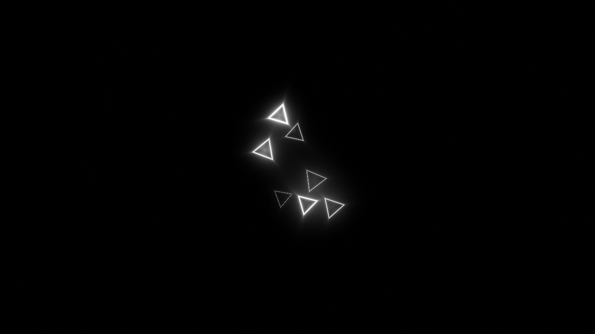
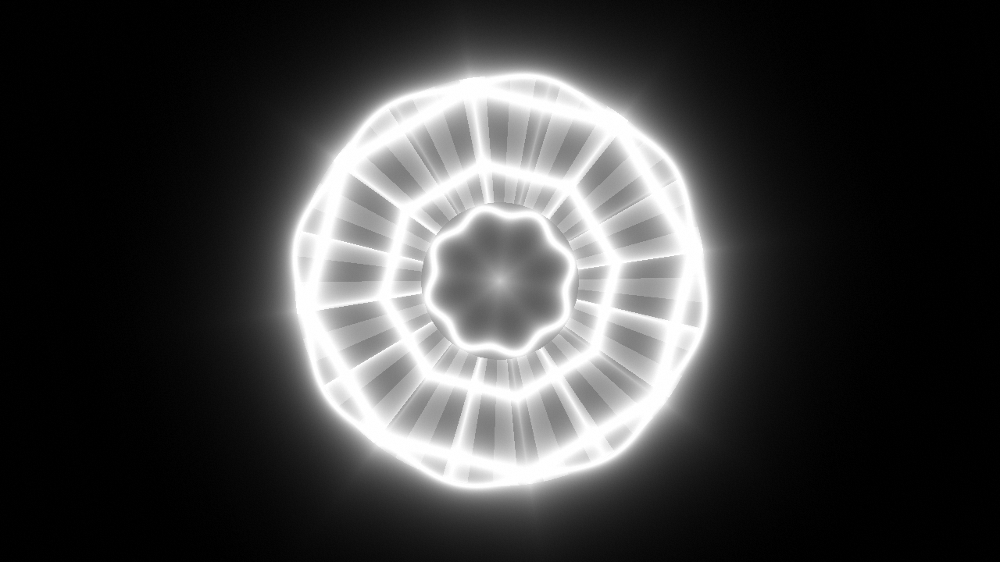
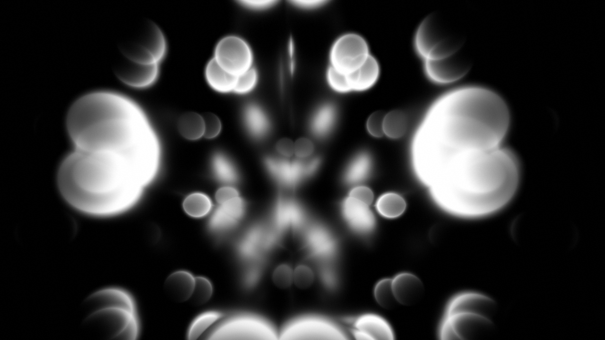
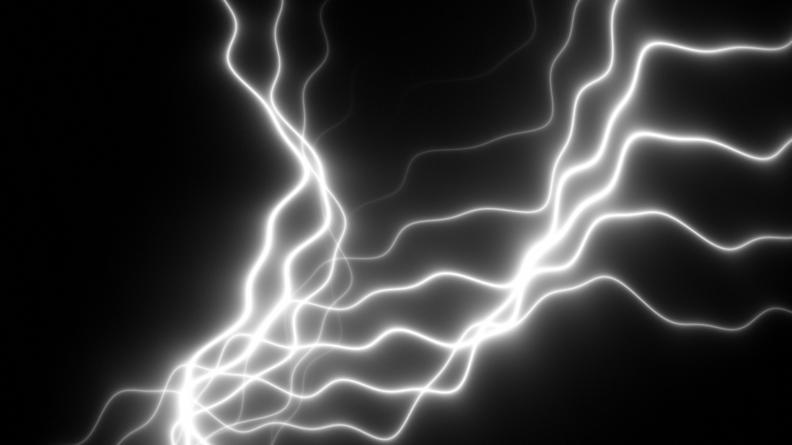

# Dem1 — local 64K intro prototype

Native macOS arm64 demo. The executable is 53,328 bytes (limit: 65,536 bytes). Only tested on an M2 Mac; Intel is unsupported. Initial Metal shader compilation can add startup time.

## Run

In Terminal from this folder:

```sh
./Dem1
```

Or double-click `Launch.command`. macOS may block this unsigned, not-notarized build. See the repository's [unsigned app instructions](../README.md#running-the-unsigned-macos-app).

- **F** (or the same physical key, **А** in Russian layout): toggle fullscreen.
- **Esc** or **⌘Q**: quit.
- The intro exits automatically.

Default window: 1152 × 648; internal rendering is capped at 1280 pixels wide for the M2 Air.

## Scene captures

### Scene 1


### Scene 2


### Scene 3


### Scene 4


## Build and capture

`source/build.sh` rebuilds with Xcode command line tools and Python 3. A separate offline Metal compiler is not needed: the executable compiles its embedded shader through the system Metal framework on launch. The build fails if the final signed executable exceeds 65,536 bytes.

```sh
./Dem1 --capture 36 tunnel.png
```

This renders one frame at 36 seconds without opening the demo window.

This is a publicly released prototype, not an approved competition submission. See [COMPO-CHECK.md](COMPO-CHECK.md) and check the current rules of any event before submitting; AI-use disclosure or other restrictions may apply.
