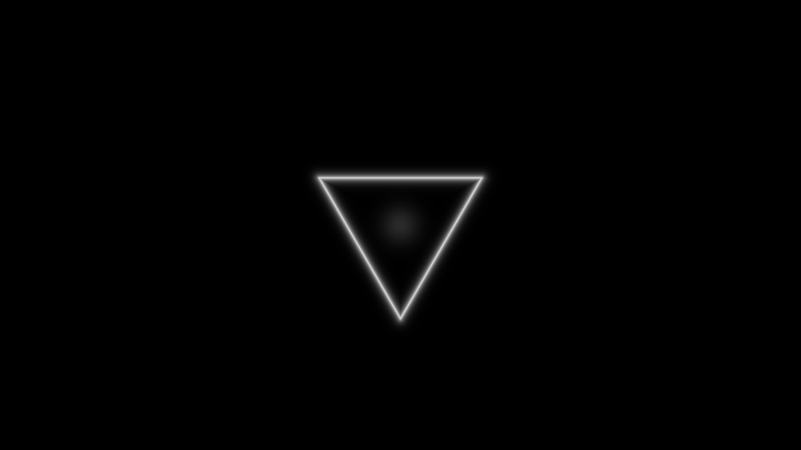
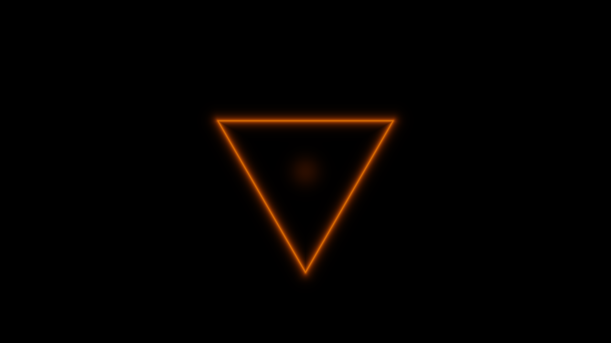
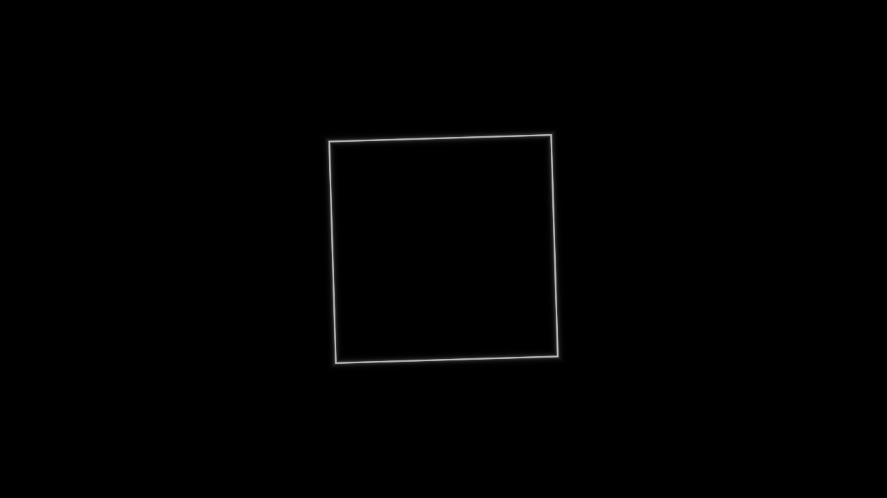
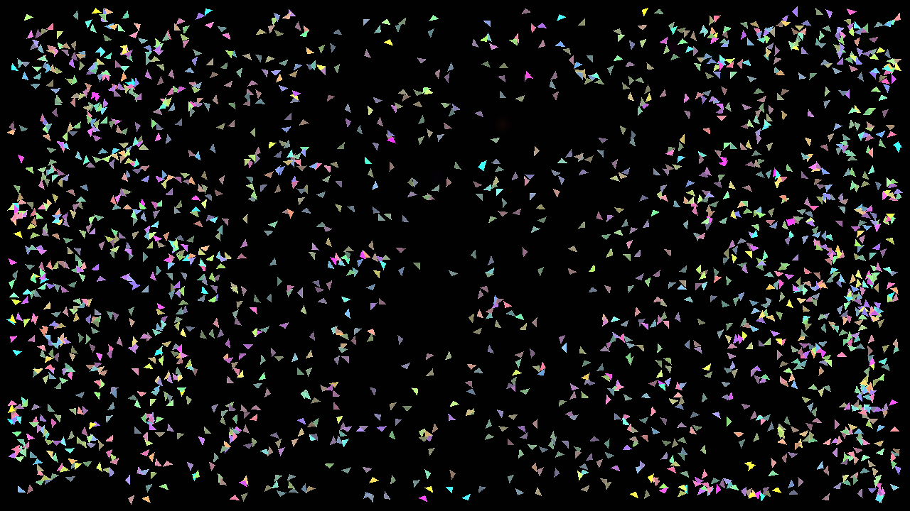
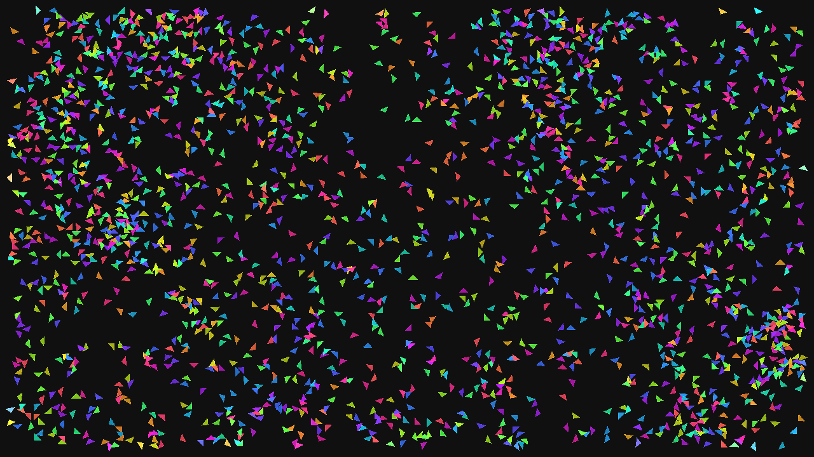
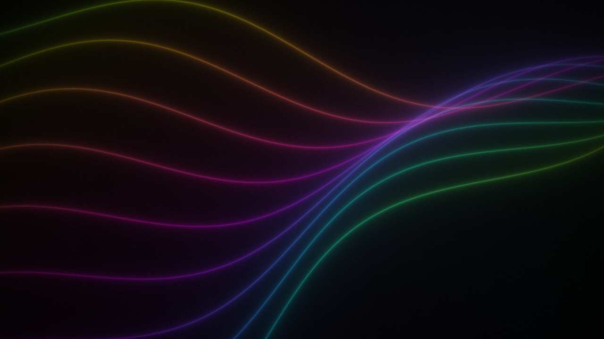
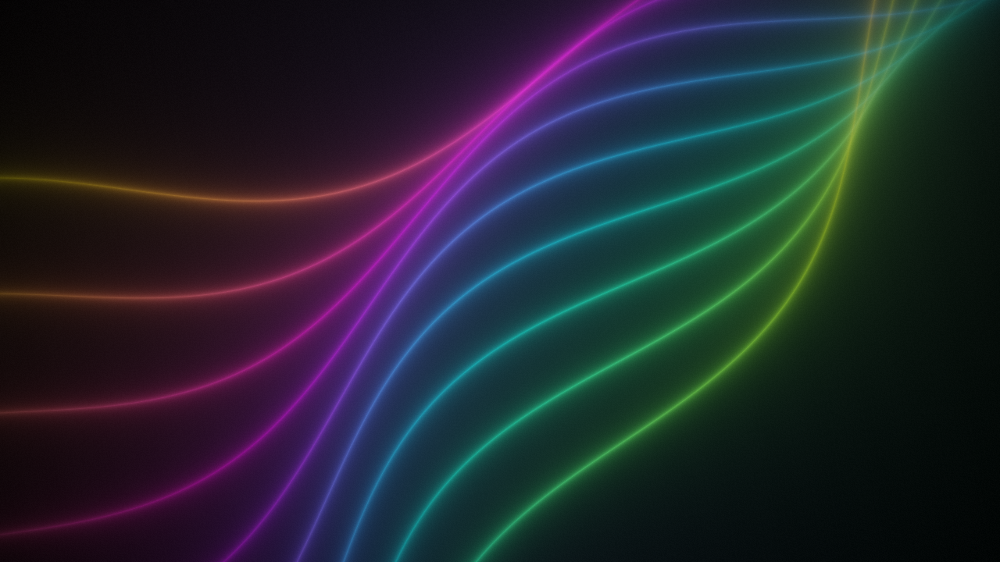

# Dem11

A real-time Metal intro with the Dem2 ambient drone.

1. Main scene: a white point opens into outlined white, yellow, red, green, blue, and orange triangles; their approaches accelerate. A white square outline then snaps to a stop, sways, spins up, and breaks into 2,048 individually simulated triangles. Each particle bounces off the frame and collides with the others, growing and flashing. For about 15 seconds their movement and color build toward whiteout, then fade to black.
2. Final scene: after black, Dem0 scene 4's colored wave lines appear over 10 seconds, growing from very fine, dim traces to their original width and brightness.

Total runtime: 51.95 seconds. Build with `source/build.sh`, then run `Dem11`.
The source is in `source/`. The build script enforces the 65,536-byte executable limit.

Controls: ←/→ switches between the two scenes; F (including Russian layout А) toggles fullscreen; Esc or Cmd+Q quits.

## Screenshots

| Main scene | Capture |
|---|---|
| Opening triangle outline |  |
| Orange approach |  |
| Square pauses |  |
| Individual fragments collide and rebound |  |
| Rainbow buildup |  |
| Whiteout |  |
| Fade to gray |  |
| Waves begin to emerge |  |
| Wave reveal after 5 seconds |  |
| Wave reveal after 10 seconds |  |
