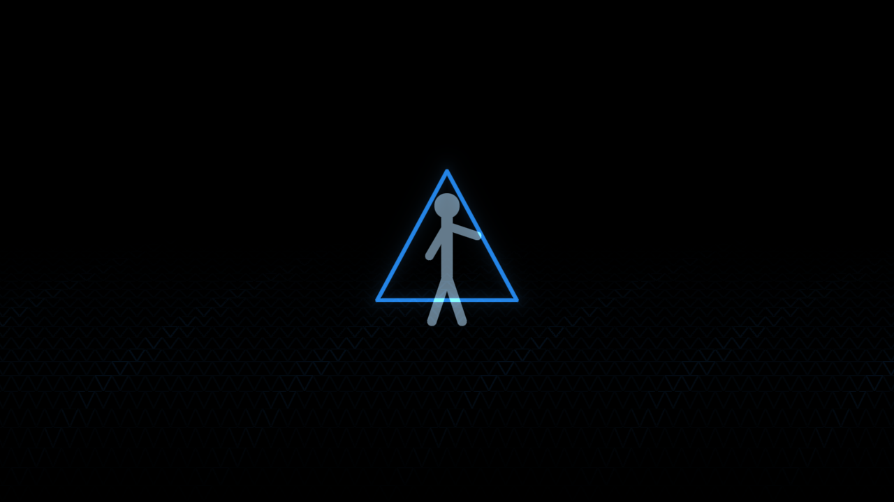
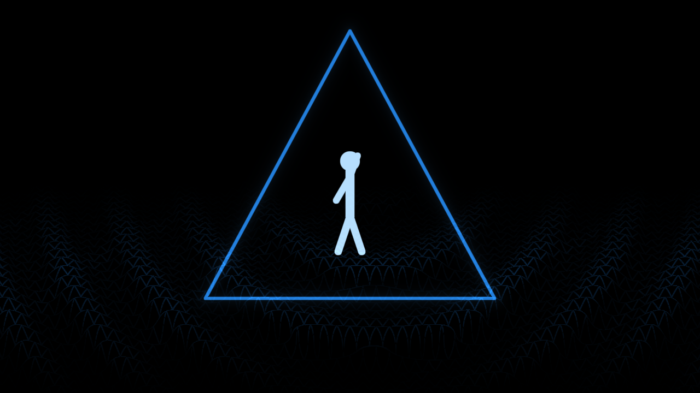
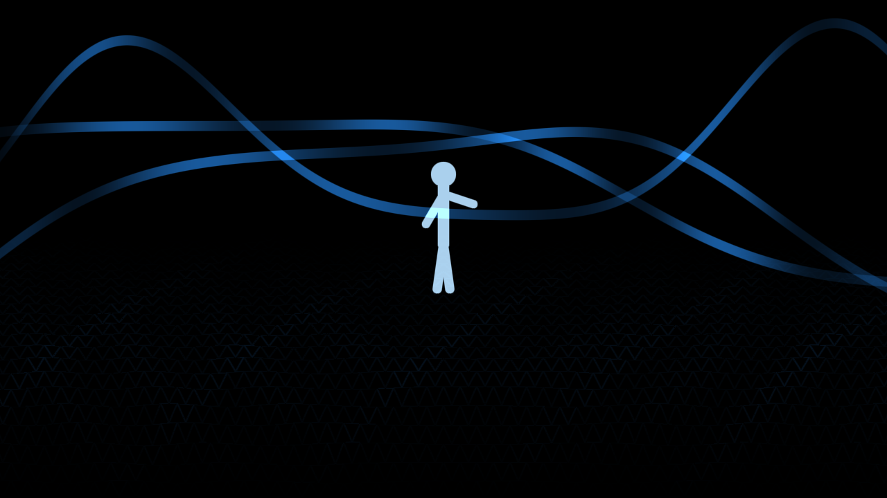
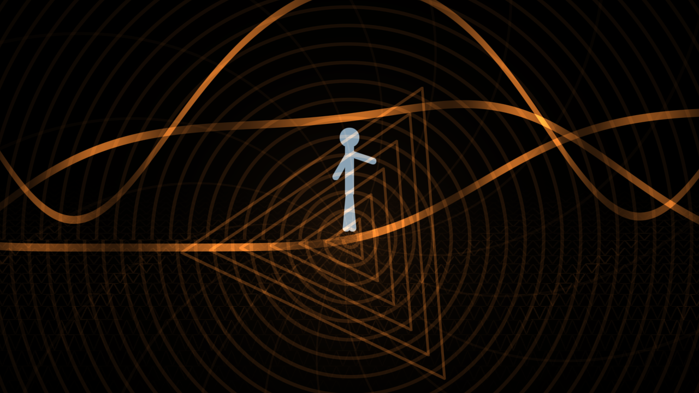
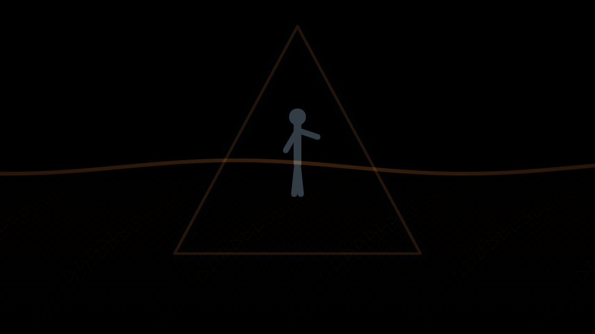
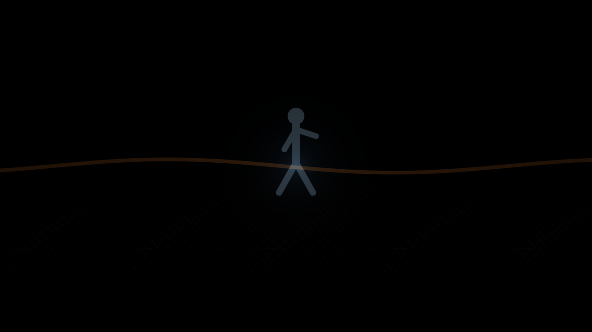

# Dem12

A short abstract Metal intro: a solitary figure wakes an infinite triangular world, sends waves through it, follows the forming path toward a luminous aperture, then watches the geometry settle into a final quiet wave and disappear.

The one continuous scene runs for 54 seconds. Its visual rhythm moves from near-black stillness through a cool blue and silver mesh into warmer amber ribbons, a brief convergence, and a slow fade. A soft, percussion-free drone combines low tones and airy harmonics, with quiet resonant pulses as each wave arrives. It swells near the climax and fades with the image.

Build with `source/build.sh`, then run `Dem12` or `Launch.command`. The build script checks the 65,536-byte executable limit. The source is in `source/`.

Controls: F (including Russian layout А) toggles fullscreen; Esc or Cmd+Q quits.

## Screenshots

| Moment | Capture |
|---|---|
| The first triangle and lone figure |  |
| A wave answers the touch |  |
| The geometry begins to move |  |
| The path gathers toward an aperture |  |
| Brief convergence flare |  |
| A quiet wave remains |  |
| The world disappears |  |
