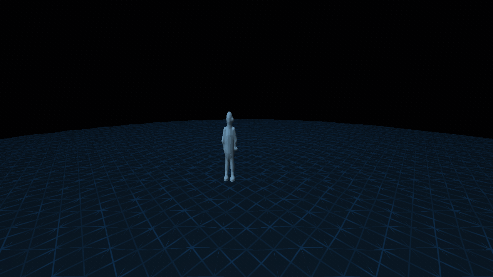
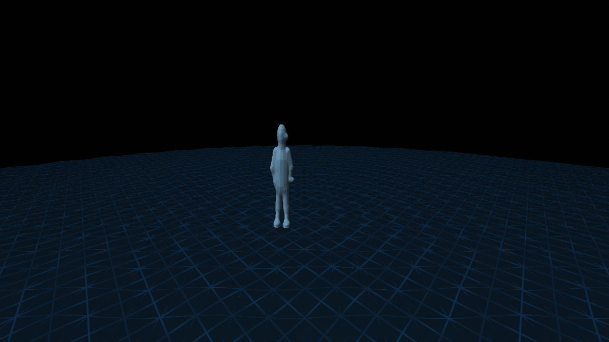
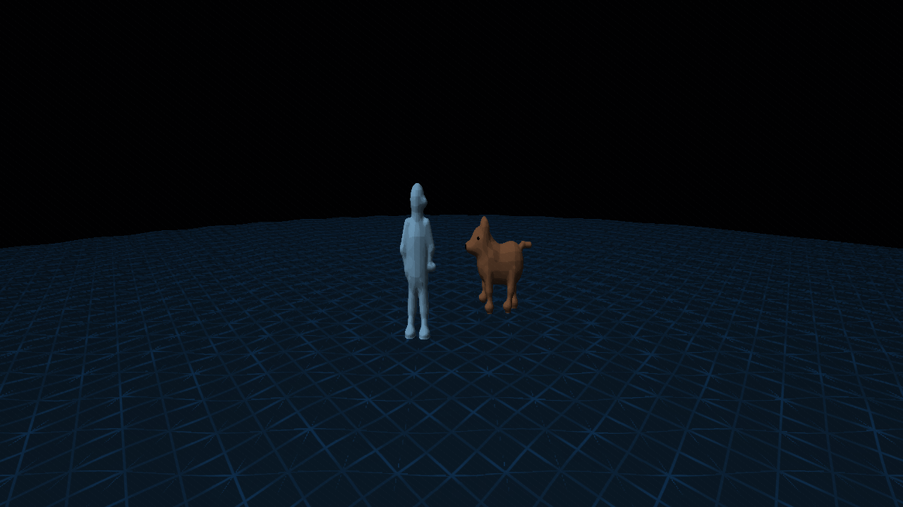
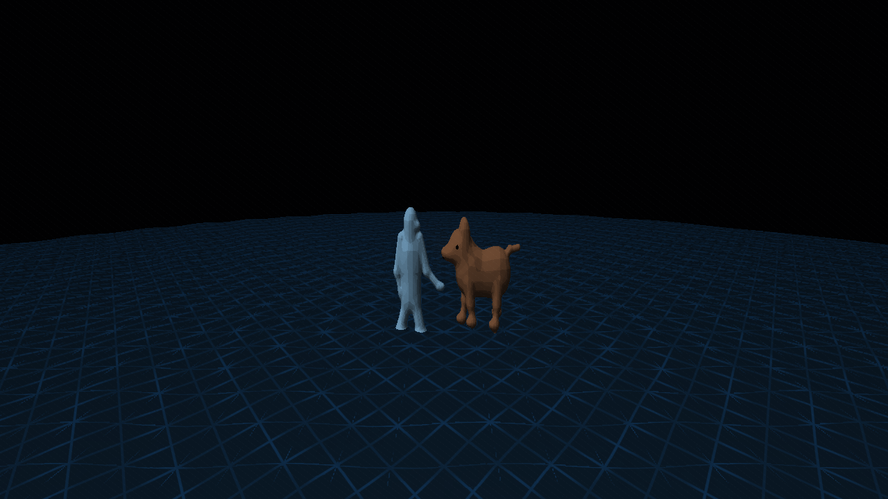
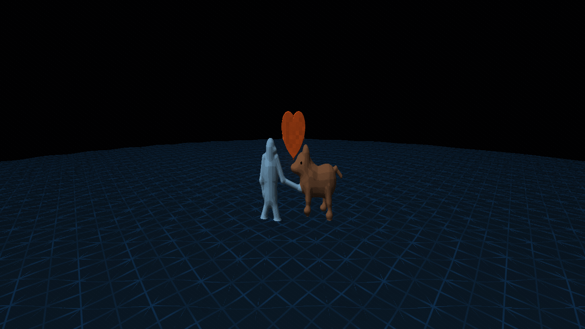
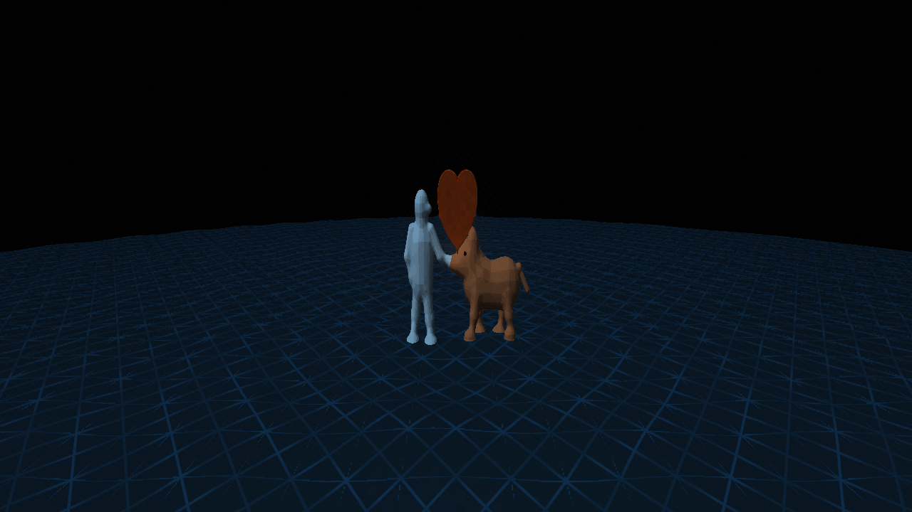
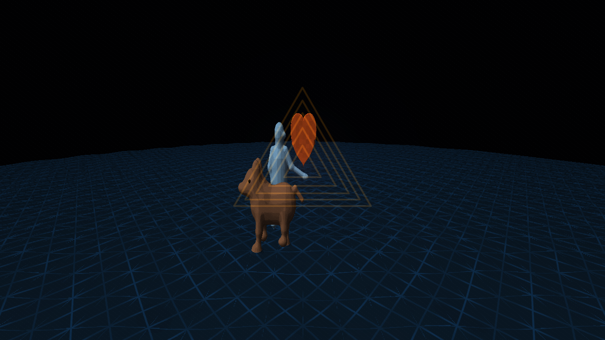
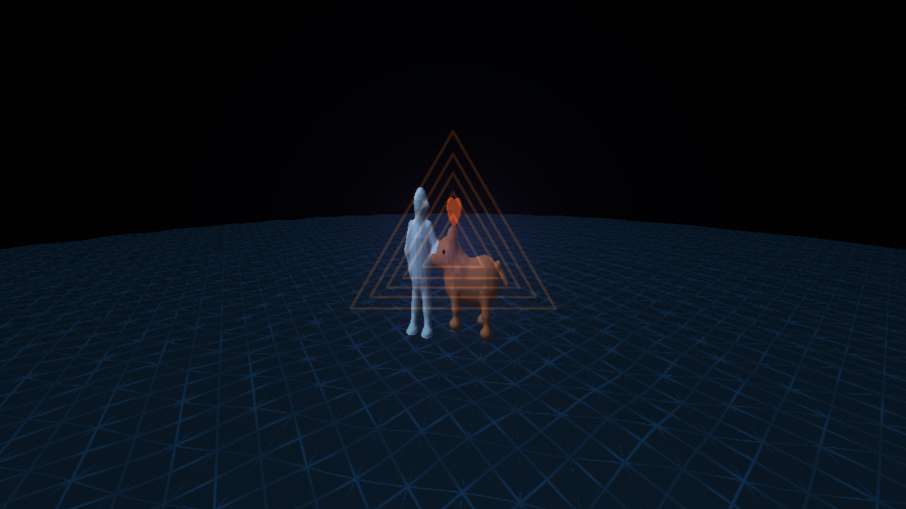
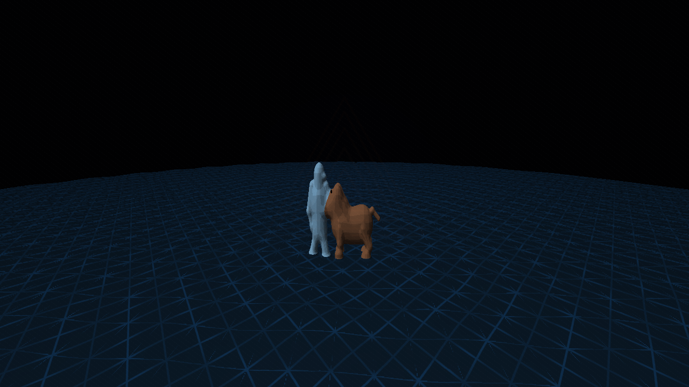

# Dem13

A 64K real-time Metal demo built around the meeting of a person and a dog in a responsive triangular world. Their bodies are modeled as connected three-dimensional volumes with softly faceted shading; they are not wireframe or stick figures. The dog emerges at the horizon, approaches, and reaches toward the person's hand. The surrounding waves converge into a warm volumetric heart, then expand into a moving portal before the pair settle together as the geometry fades.

The one continuous scene lasts 64 seconds. Sound is a quiet low drone with airy harmonics, gentle resonant heart pulses, and soft step tones; no hard percussion.

Build with `source/build.sh`, then run `Dem13` or `Launch.command`. The build script checks the 65,536-byte executable limit. Source files are in `source/`.

Controls: F (including Russian layout А) toggles fullscreen; Esc or Cmd+Q quits.

## Screenshots

| Moment | Capture |
|---|---|
| The lone figure in the triangular world |  |
| Warm heart pulses wake the surface |  |
| The dog begins to form at the horizon |  |
| The two waves meet on the path |  |
| The volumetric heart gathers between them |  |
| A warm wave transforms the triangular world |  |
| They move together through a spiral field |  |
| The heart portal opens |  |
| The scene settles into the quiet ending |  |
