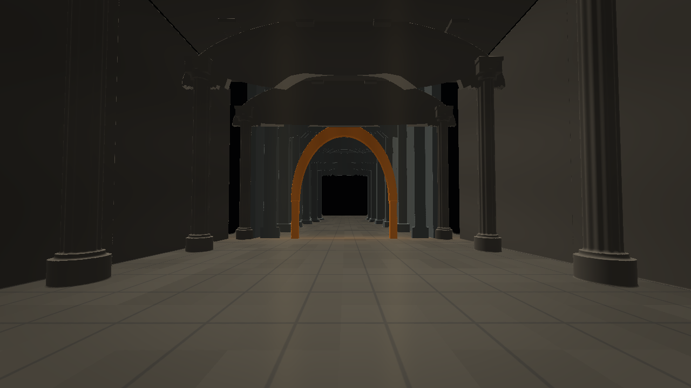
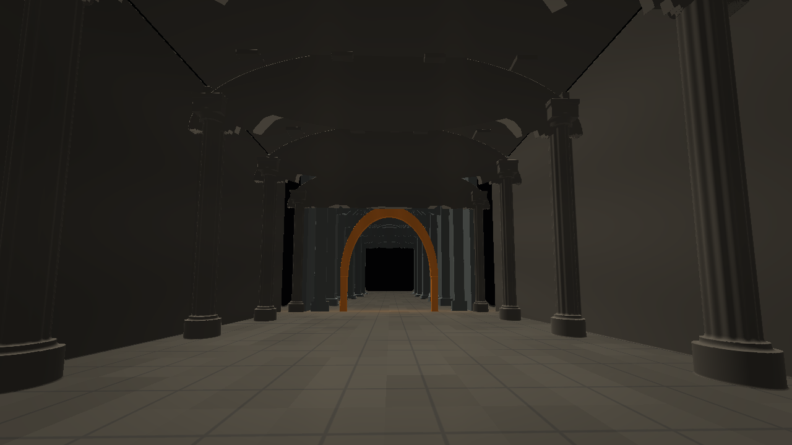
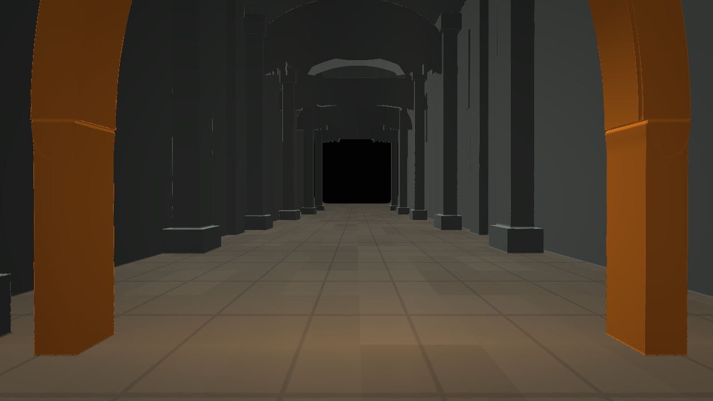
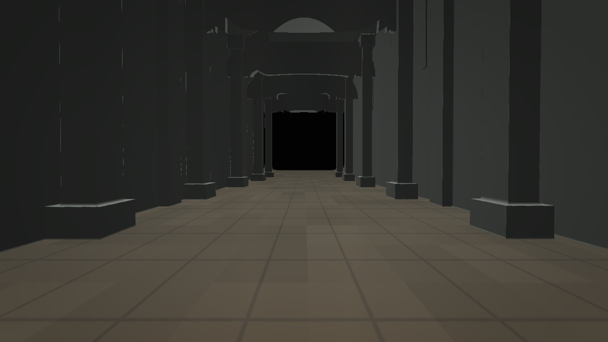
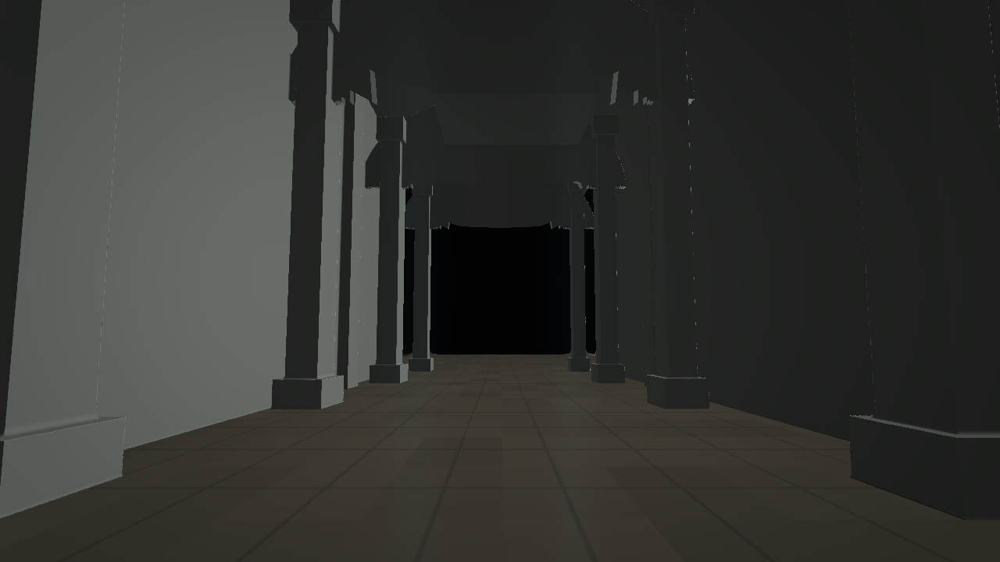
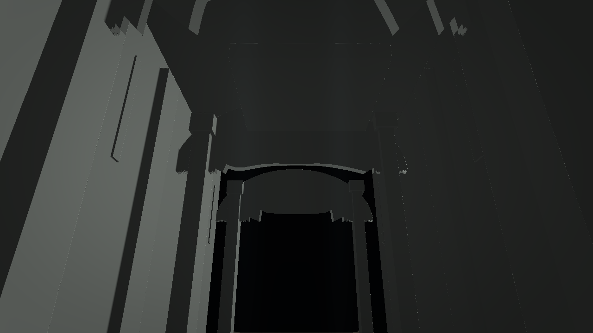
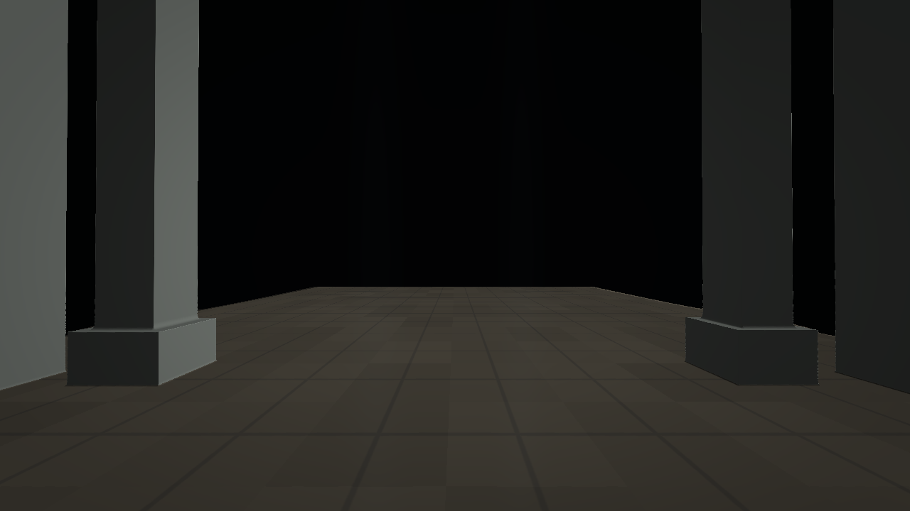

# Dem14

A continuous 57-second first-person Metal demo through two deterministic procedural architectural halls. The first nave uses paired fluted limestone columns, joined bases and capitals, repeating elliptical vault ribs, deep wall bays and a tiled stone floor. A solid gold arch bridges into a narrower second hall with offset rectangular piers, crossing load-bearing ribs, a high asymmetric vault, slit lighting and a roof-hung canopy.

The camera follows a slow eased path, pauses to look around, then passes through the arch without a cut. Warm top light gradually gives way to cooler side light. A low drone, airy resonance and quiet echoed step tones accompany the walk.

Build with `source/build.sh`, then run `Dem14` or `Launch.command`. The build script checks the 65,536-byte executable limit. The source is in `source/`.

Controls: F (including Russian layout А) toggles fullscreen; Esc or Cmd+Q quits.

## Screenshots

| Moment | Capture |
|---|---|
| First nave and its repeating arches |  |
| Looking up into the limestone vault |  |
| Approach to the golden arch |  |
| Passing through the portal |  |
| The second hall's asymmetric piers |  |
| Crossing ribs and the suspended canopy |  |
| Final view of the second nave |  |
