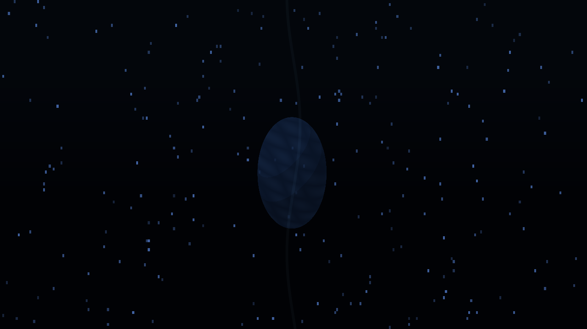
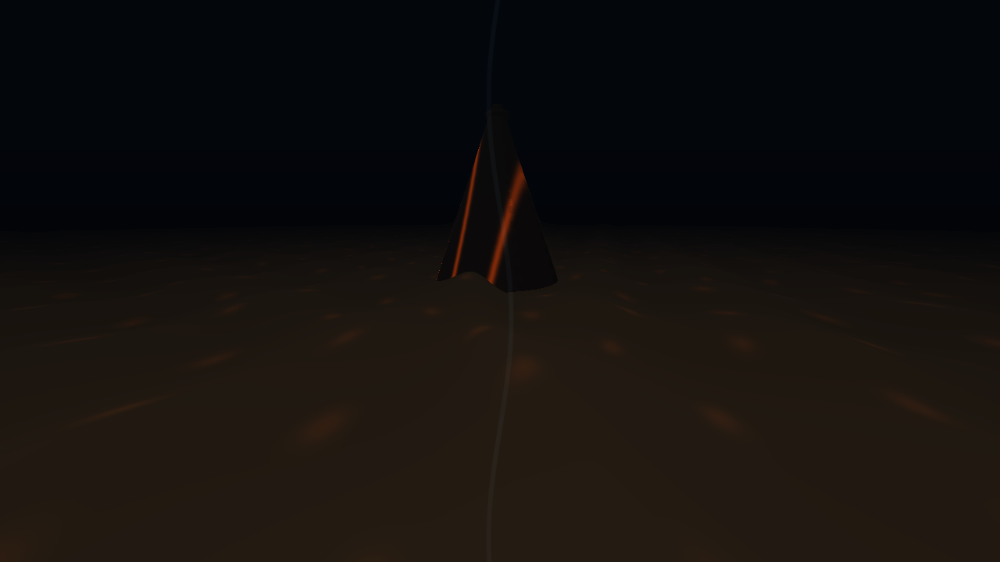
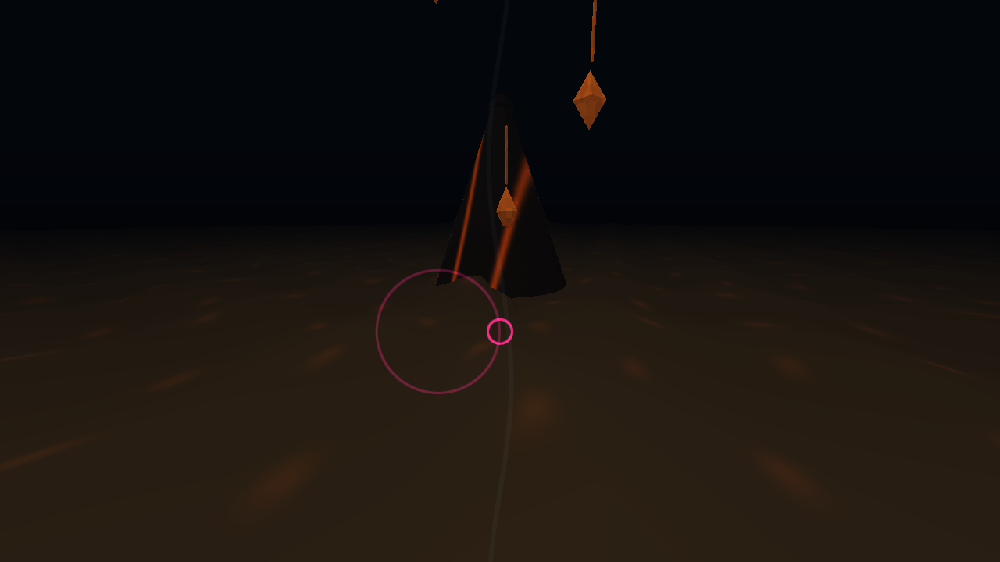
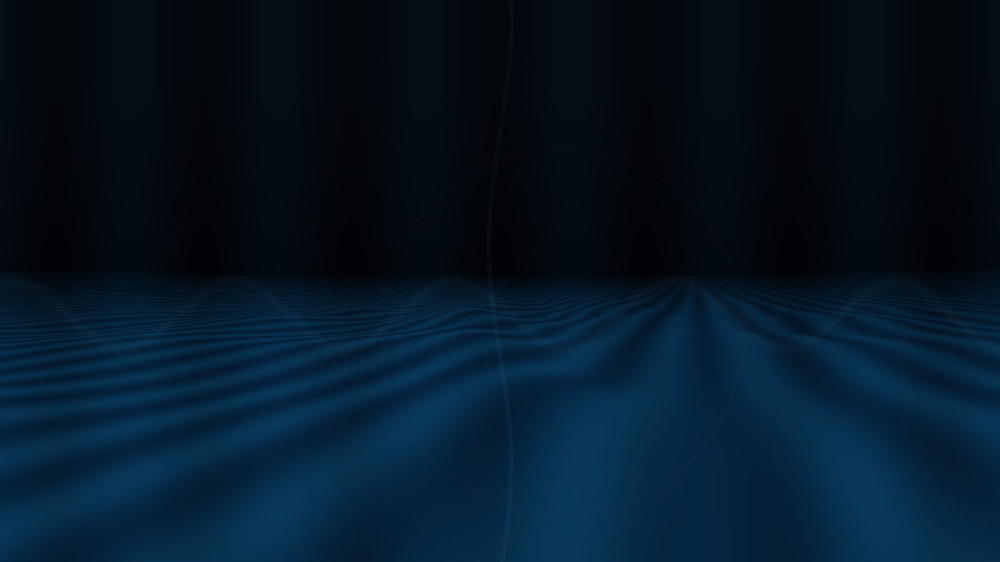
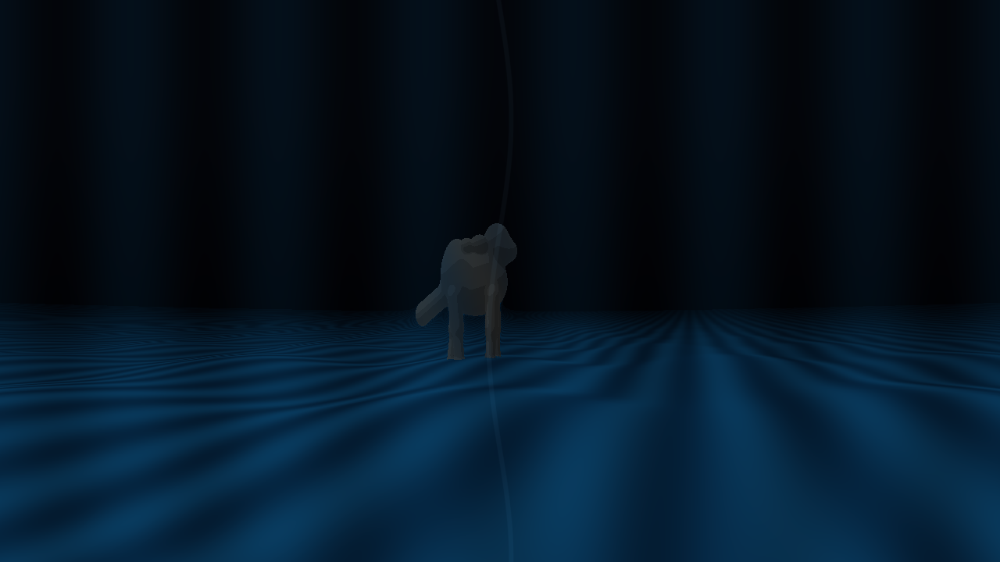
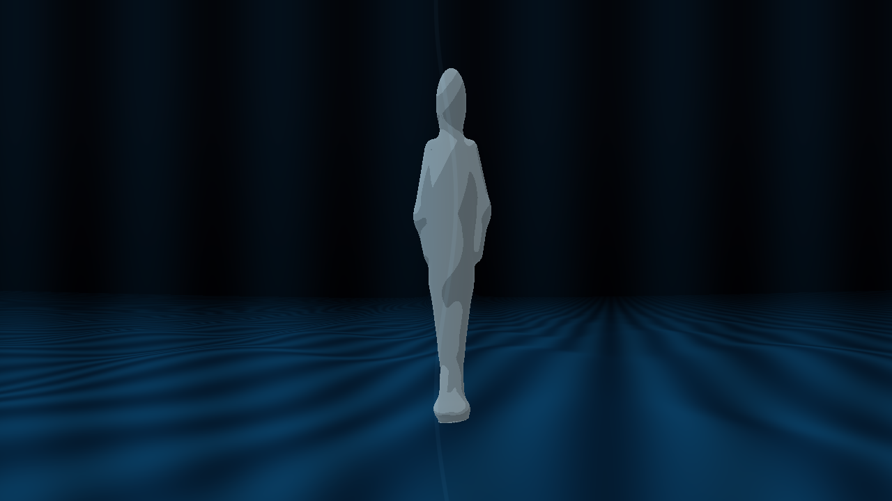
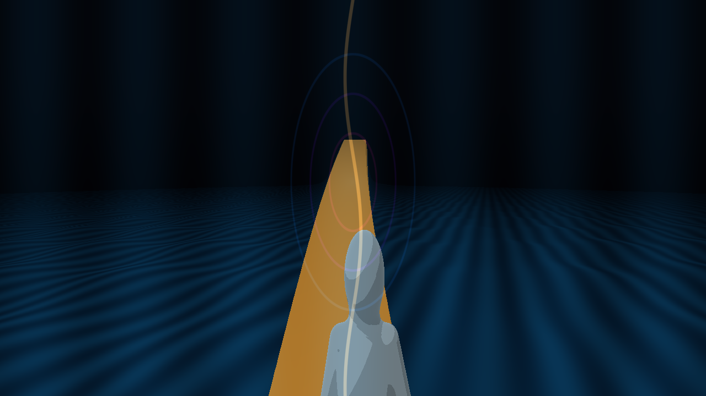

# Dem15

A continuous 60-second abstract journey through the emergence of a living world: a dark planet and orbiting forms, a faceted volcanic landscape, falling meteors and impact waves, blue water, a walking animal silhouette, and a human figure following a road that rises into space. The eras blend through shared terrain, light, and wave motion rather than hard cuts.

The forms use a restrained 3D palette of deep space blue, ember amber, water blue, and muted earth tones. Sound layers a quiet low drone, airy resonance, soft impact pulses, water tones, and a few gentle footsteps.

Build with `source/build.sh`, then run `Dem15` or `Launch.command`. The build script checks the 65,536-byte executable limit. Source files are in `source/`.

Controls: F (including Russian layout А) toggles fullscreen; Esc or Cmd+Q quits.

## Screenshots

| Epoch | Capture |
|---|---|
| Planet in dark space |  |
| Volcanic terrain and flowing lava |  |
| Faceted meteors reshape the land |  |
| The camera glides over water |  |
| A large animal form crosses the terrain |  |
| The human figure finds the road |  |
| The path lifts into the final orbit |  |
