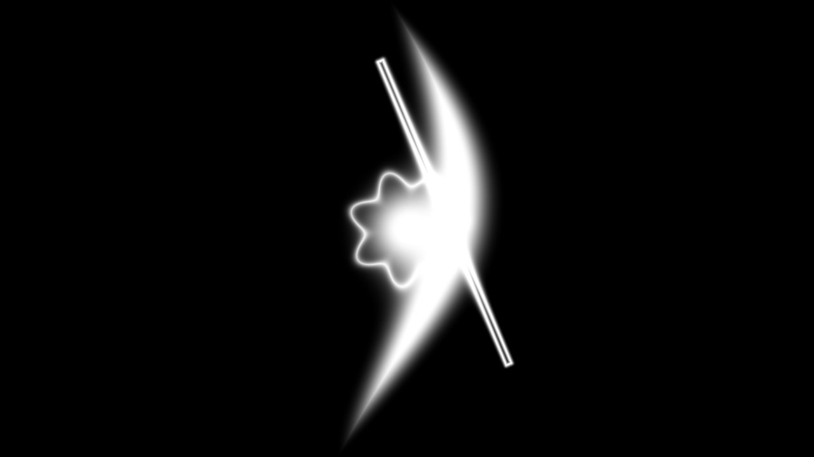
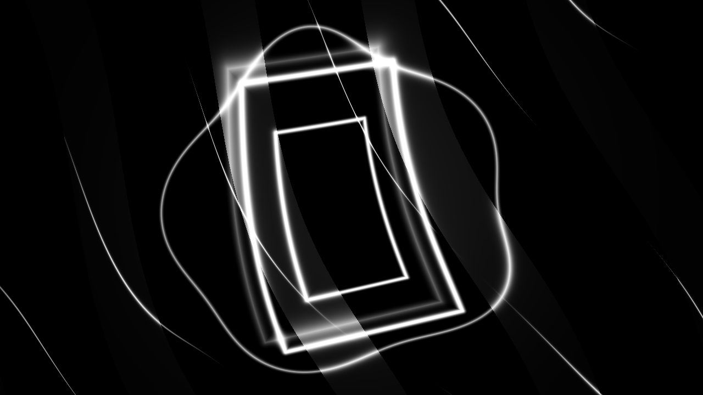

# Dem3 — AFTERIMAGE

Silent monochrome three-scene intro for Apple Silicon macOS. Runtime: 96 seconds. The 52,864-byte executable is ad-hoc signed, but has no Developer ID signature and is not notarized. It has been tested on an M2 Mac; Intel is unsupported.

## Run

From Terminal in this folder:

```sh
./Dem3
```

If Gatekeeper blocks the downloaded file, follow the repository's [macOS launch instructions](../README.md#running-a-macos-demo-without-developer-id-signing-or-notarization).

- **Right** or **Down**: next scene.
- **Left** or **Up**: previous scene.
- **F** (or the same physical key, **А** in Russian layout): toggle fullscreen.
- **Esc** or **⌘Q**: quit.

## Scene captures

### Scene 1


### Scene 2


### Scene 3


## Build

`source/build.sh` rebuilds with Xcode command line tools and Python 3. It enforces the 65,536-byte executable limit. Metal shader compilation at launch requires a Mac with Metal support.

See [COMPO-CHECK.md](COMPO-CHECK.md) before considering a competition submission.
