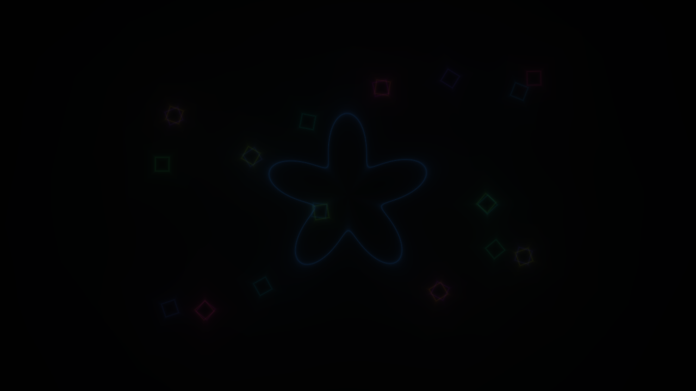
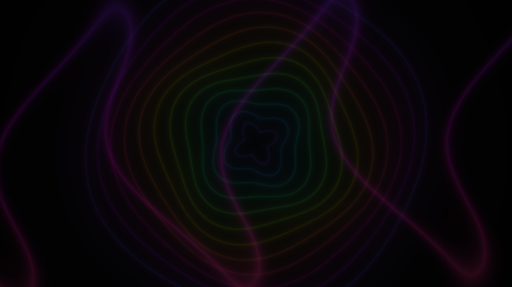

# Dem7

A silent, 96-second color intro for Apple Silicon macOS, built as a native executable under the 65,536-byte limit. It unfolds across three animated scenes.

**Controls:** Right/Down arrow — next scene; Left/Up arrow — previous scene; F or А — fullscreen; Esc or Cmd+Q — quit.

## Scene captures






## Run

This arm64 macOS executable has an ad-hoc signature and is not notarized. Gatekeeper may prevent it from opening. From Terminal:

```sh
xattr -d com.apple.quarantine ./Dem7
./Dem7
```

Or Control-click `Launch.command` in Finder and choose **Open**.

## Build

Requires Xcode Command Line Tools and Python 3. Run `source/build.sh`; the build script checks the executable against the 65,536-byte limit. See [BUILD.json](BUILD.json) and [COMPO-CHECK.md](COMPO-CHECK.md) for build metadata and review notes.
